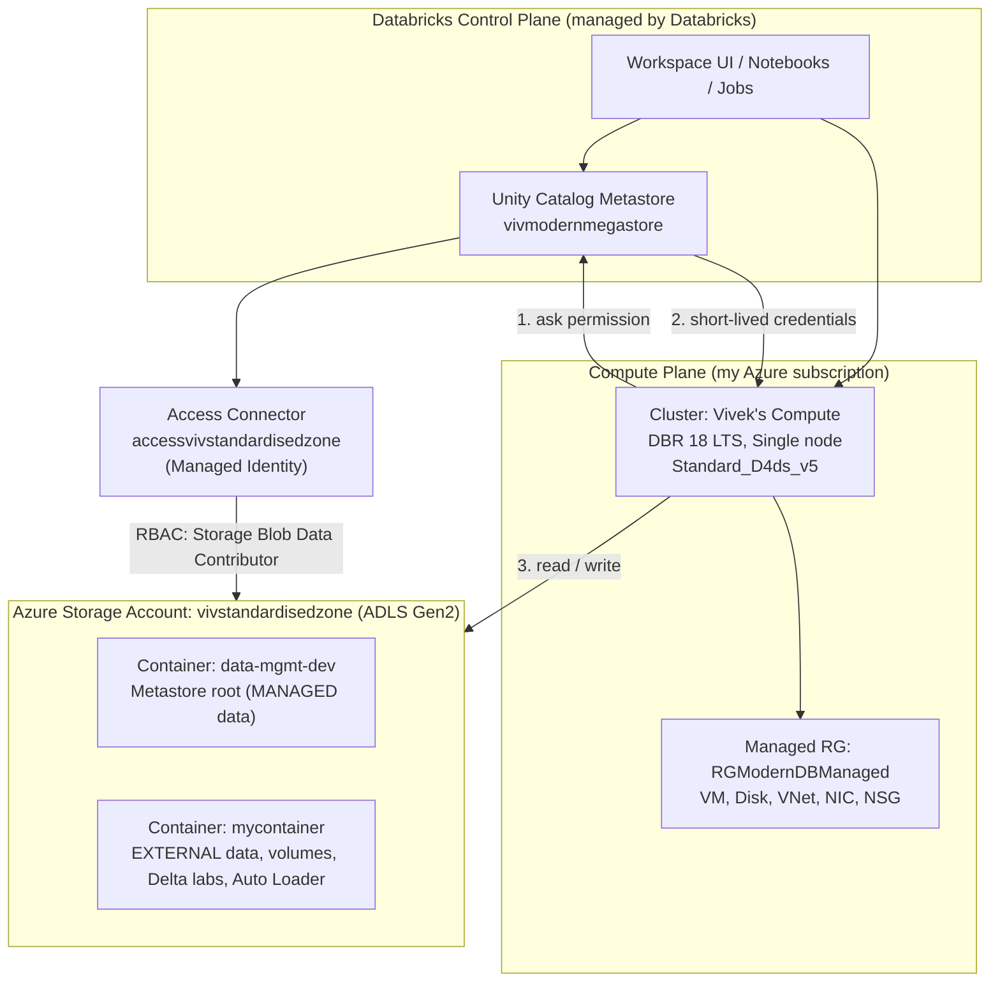
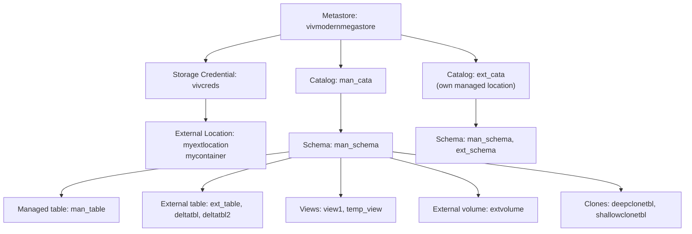

# 🧱 Azure Databricks Lakehouse with Unity Catalog and Delta Lake

### A hands-on project: building a governed Lakehouse on Azure from scratch, then exploring Delta Lake internals, Deletion Vectors, Clones and Auto Loader

<br>


---

## 🎯 Project Overview

This repository documents my **end-to-end hands-on journey with Azure Databricks**, from creating the cloud resources to building a **governed Lakehouse** with **Unity Catalog**, and then exploring how **Delta Lake** works internally.

The project answers three questions:

| Question | Where it is answered |
|---|---|
| *How do I set up Azure Databricks + Unity Catalog properly, with my own storage and no secrets?* | [Part 1](#-part-1-environment-setup-step-by-step) |
| *How does Unity Catalog organize and govern data (managed/external tables, views, volumes)?* | [Part 2](#-part-2-unity-catalog-hands-on) |
| *What really happens inside a Delta table (transaction log, time travel, deletion vectors, clones, Auto Loader)?* | [Parts 3 to 5](#-part-3-delta-lake-deep-dive) |

> 💡 Everything here was **actually executed** in my own Azure subscription (resource names are shown exactly as I used them), and each experiment was **verified by inspecting the files in Azure Storage** and the Delta transaction log.

---

## ✨ What I Built (at a Glance)

- ✅ Provisioned an **Azure Databricks workspace** (Hybrid type) with a **managed resource group**
- ✅ Created a custom **Unity Catalog metastore** backed by **ADLS Gen2** (own storage account and container)
- ✅ Connected Databricks to storage **without keys**, using an **Access Connector (managed identity)** with the *Storage Blob Data Contributor* role
- ✅ Created **storage credential** and **external location** for governed external data access
- ✅ Built **managed / external** catalogs, schemas and tables in **4 different storage-location scenarios**
- ✅ Practised **DROP / UNDROP**, permanent vs temporary **views**, and **external volumes**
- ✅ Explored **Delta Lake internals**: `_delta_log`, JSON commits, `.crc`, checkpoints
- ✅ Demonstrated **copy-on-write vs deletion vectors (merge-on-read)** side by side
- ✅ Used **time travel** and **RESTORE**
- ✅ Compared **Deep Clone vs Shallow Clone**
- ✅ Implemented **incremental ingestion with Auto Loader** (`cloudFiles`) and inspected the checkpoint, schema and sink folders

---

## 🏗 Architecture

### High-level (Azure + Databricks + Unity Catalog)



### Unity Catalog object hierarchy used in this project



### Where does the data go? (managed location resolution)

```
Table's catalog/schema has a MANAGED LOCATION?
        │
        ├── Schema level  → use schema location      (most specific)
        ├── Catalog level → use catalog location
        └── Neither       → use metastore root storage (data-mgmt-dev)
```

---

## 🧰 Tech Stack

| Layer | Technology |
|---|---|
| **Cloud** | Microsoft Azure (Resource Groups, Storage Accounts, Access Connector, RBAC, Entra ID) |
| **Data platform** | Azure Databricks (Hybrid workspace), Databricks Runtime **18 LTS** |
| **Governance** | Unity Catalog (metastore, catalogs, schemas, credentials, external locations, volumes) |
| **Storage** | Azure Data Lake Storage Gen2 (hierarchical namespace), Parquet, Delta Lake |
| **Processing** | Apache Spark, Spark SQL, PySpark, Structured Streaming |
| **Ingestion** | Auto Loader (`cloudFiles`) |
| **Security** | Managed identity, Azure RBAC (*Storage Blob Data Contributor*), MFA |
| **Tooling** | Databricks notebooks, magic commands (`%sql`, `%python`), `dbutils`, Git/GitHub |

---

## 🛠 Part 1: Environment Setup, Step by Step

> **Goal:** a Unity Catalog-enabled workspace where *all* data lands in **my own** ADLS Gen2 storage and access is secret-less.

| # | Step | What I did | Why |
|---|---|---|---|
| 1 | **Workspace** | Created Azure Databricks workspace `VIV_ADB` (type **Hybrid**), managed RG `RGModernDBManaged` | Hybrid supports classic and serverless compute |
| 2 | **Account console** | Logged in to `accounts.azuredatabricks.net` with my Entra UPN, set password and Authenticator (MFA) | Account-level objects (metastores, users) are managed here |
| 3 | **Reset metastore** | Deleted the existing default metastore | To create one on my own storage (fresh learning environment only) |
| 4 | **Storage** | Created storage account `vivstandardisedzone` (ADLS Gen2) with containers `data-mgmt-dev` (metastore root) and `mycontainer` (external) | Separate **managed** vs **external** data |
| 5 | **Access Connector** | Created *Access Connector for Azure Databricks* `accessvivstandardisedzone` | Gives Databricks a managed identity (no keys) |
| 6 | **RBAC** | Storage account → Access control (IAM) → Add role assignment → **Storage Blob Data Contributor** → Managed identity → the access connector | Data-plane permission to read/write/delete blobs |
| 7 | **Metastore** | Created `vivmodernmegastore` in **Central India**, root `abfss://data-mgmt-dev@vivstandardisedzone.dfs.core.windows.net/`, access connector ID, attached to `VIV_ADB` | Enables Unity Catalog on the workspace |
| 8 | **Compute** | Created *Vivek's Compute*: DBR **18 LTS**, **single node**, `Standard_D4ds_v5`, auto-terminate **20 min** | Cost-effective learning cluster |
| 9 | **Admin fix** | Replaced my UPN with my Databricks account identity as admin | "Create catalog" was missing because my UPN had no `CREATE CATALOG` privilege |
| 10 | **Storage credential** | Created `vivcreds` using the access connector ID | The "ID card" for storage access |
| 11 | **External location** | Created `myextlocation` → `abfss://mycontainer@vivstandardisedzone.dfs.core.windows.net/` using `vivcreds` | Governed "door" to the external container |

Behind the scenes, Databricks created **VM, disk, virtual network and network interface** inside `RGModernDBManaged` when the cluster started.

---

## 📚 Part 2: Unity Catalog Hands-on

### Scenario matrix: where does each table's data live?

| # | Catalog | Schema | Table | Physical storage |
|---|---|---|---|---|
| 1 | Managed (default) | Managed (default) | Managed | Metastore root → `data-mgmt-dev` |
| 2 | **Own `MANAGED LOCATION`** | Default | Managed | `mycontainer/external_catalog` |
| 3 | Own `MANAGED LOCATION` | **Own `MANAGED LOCATION`** | Managed | `mycontainer/ext_schema` |
| 4 | Default | Default | **External** (`LOCATION`) | `mycontainer/ext_table/man_table3` |

<details>
<summary><b>📄 Click to view the SQL for all scenarios</b></summary>

```sql
-- Scenario 1: managed catalog, managed schema, managed table
CREATE CATALOG man_cata;
CREATE SCHEMA  man_cata.man_schema;
CREATE TABLE   man_cata.man_schema.man_table (id INT, name STRING) USING DELTA;

-- Scenario 2: catalog with its own managed location
CREATE CATALOG ext_cata
MANAGED LOCATION 'abfss://mycontainer@vivstandardisedzone.dfs.core.windows.net/external_catalog';
CREATE SCHEMA ext_cata.man_schema;
CREATE TABLE  ext_cata.man_schema.man_table2 (id INT, name STRING) USING DELTA;

-- Scenario 3: schema with its own managed location
CREATE SCHEMA ext_cata.ext_schema
MANAGED LOCATION 'abfss://mycontainer@vivstandardisedzone.dfs.core.windows.net/ext_schema';
CREATE TABLE ext_cata.ext_schema.man_table3 (id INT, name STRING) USING DELTA;

-- Scenario 4: external table (LOCATION clause)
CREATE TABLE man_cata.man_schema.ext_table (id INT, name STRING)
USING DELTA
LOCATION 'abfss://mycontainer@vivstandardisedzone.dfs.core.windows.net/ext_table/man_table3';
```
</details>

### Managed vs External table

| | Managed | External |
|---|---|---|
| Storage controlled by | Unity Catalog | Me (`LOCATION`) |
| `DROP TABLE` | Metadata **and data** removed | Only metadata removed, files stay |
| `UNDROP` | ✅ within 7 days | n/a (recreate with same path) |
| Requires external location | No | Yes |

```sql
DROP   TABLE man_cata.man_schema.man_table;   -- disappears from workspace
UNDROP TABLE man_cata.man_schema.man_table;   -- restored (within 7 days)
```

### Querying files, views and volumes

```sql
-- Query files directly by path
SELECT * FROM delta.`abfss://mycontainer@vivstandardisedzone.dfs.core.windows.net/ext_table/man_table3` WHERE id = 1;

-- Permanent view (stored in Unity Catalog, shareable, governed)
CREATE VIEW man_cata.man_schema.view1 AS
SELECT * FROM delta.`abfss://mycontainer@vivstandardisedzone.dfs.core.windows.net/ext_table/man_table3` WHERE id = 1;

-- Temporary view (session-only, not governed)
CREATE OR REPLACE TEMP VIEW temp_view AS
SELECT * FROM delta.`abfss://mycontainer@vivstandardisedzone.dfs.core.windows.net/ext_table/man_table3` WHERE id = 1;
```

| | Permanent view | Temporary view |
|---|---|---|
| Stored in | Unity Catalog | Spark session memory |
| Lifetime | Until dropped | Until session ends |
| Shareable / grantable | ✅ | ❌ |

```python
# External Volume: governed access to files
dbutils.fs.mkdirs('abfss://mycontainer@vivstandardisedzone.dfs.core.windows.net/volumes')
```
```sql
CREATE EXTERNAL VOLUME man_cata.man_schema.extvolume
LOCATION 'abfss://mycontainer@vivstandardisedzone.dfs.core.windows.net/volumes';

SELECT * FROM csv.`/Volumes/man_cata/man_schema/extvolume/Sales`;
```

---

## 🔬 Part 3: Delta Lake Deep Dive

> **Delta table = Parquet data files + `_delta_log` transaction log.**
> Parquet files are **immutable**, so every change creates new files and a new log entry.

### 3.1 Table layout in storage

```
deltalake/deltatbl/
├── _delta_log/
│   ├── 00000000000000000000.json      ← version 0 (commit: actions)
│   ├── 00000000000000000000.crc       ← version 0 checksum / summary
│   ├── ...
│   ├── 00000000000000000010.checkpoint.parquet
│   └── _last_checkpoint
├── part-00000-....snappy.parquet      ← data files
└── part-00001-....snappy.parquet
```

| File | Purpose |
|---|---|
| `NNN.json` | Commit file: actions `add`, `remove`, `metaData`, `protocol`, `commitInfo` |
| `NNN.crc` | Per-version checksum/summary (size, file count, metadata) for validation and speed |
| `*.checkpoint.parquet` | Full table state every ~10 commits (fast snapshot loading) |
| `_last_checkpoint` | Pointer to the latest checkpoint |

### 3.2 Experiment A: classic UPDATE (deletion vectors **disabled**), i.e. copy-on-write

```sql
CREATE TABLE man_cata.man_schema.deltatbl (id INT, name STRING, city STRING)
USING DELTA
LOCATION 'abfss://mycontainer@vivstandardisedzone.dfs.core.windows.net/deltalake/deltatbl';

ALTER TABLE man_cata.man_schema.deltatbl SET TBLPROPERTIES ('delta.enableDeletionVectors' = false);

INSERT INTO man_cata.man_schema.deltatbl VALUES (1,'aa','delhi'),(2,'bb','mumbai'),(3,'cc','chennai');

UPDATE man_cata.man_schema.deltatbl SET city = 'toronto' WHERE id = 1;
```

**Observation in Azure Storage:** after the update there were **two Parquet files**.

```
BEFORE UPDATE (v2)              AFTER UPDATE (v3)
File 1: 3 rows (active)         File 1: 3 rows  → marked "removed" in log (kept for time travel)
                                File 2: 3 rows  → NEW file with the latest data (active)
```

**Why:** Parquet can't be edited in place. Delta **rewrites the whole affected file**, then records `remove File 1` and `add File 2` in the log. The old file stays on storage until `VACUUM`, which is what makes **time travel** possible.

### 3.3 Time travel and RESTORE

```sql
DESCRIBE HISTORY man_cata.man_schema.deltatbl;                              -- audit trail of all versions
SELECT * FROM man_cata.man_schema.deltatbl VERSION AS OF 2;                 -- read old data
RESTORE man_cata.man_schema.deltatbl TO VERSION AS OF 2;                    -- revert (creates a new version)
```

| Version | Operation | Active file |
|---|---|---|
| 0 | CREATE TABLE | – |
| 1 | SET TBLPROPERTIES | – |
| 2 | WRITE (INSERT) | File 1 |
| 3 | UPDATE | File 2 |
| 4 | RESTORE (to v2) | File 1 |

`RESTORE` copies **no data**; it only re-points the log to the older files, so it is fast.

### 3.4 Experiment B: UPDATE with **deletion vectors enabled** (merge-on-read)

```sql
CREATE TABLE man_cata.man_schema.deltatbl2 (id INT, name STRING, city STRING)
USING DELTA
LOCATION 'abfss://mycontainer@vivstandardisedzone.dfs.core.windows.net/deltalake/deltatbl2';

INSERT INTO man_cata.man_schema.deltatbl2 VALUES (1,'aa','delhi'),(2,'bb','mumbai'),(3,'cc','chennai');

UPDATE man_cata.man_schema.deltatbl2 SET city = 'seattle' WHERE id = 1;
```

**Observation in Azure Storage:** **3 Parquet files + 1 deletion vector (`.bin`) file.**

| Item | Meaning |
|---|---|
| Original data files (2) | Written by the insert (Spark writes files in parallel) |
| `part-…-C.parquet` | New small file with **only the updated row** `(1,aa,seattle)` |
| `deletion_vector_<uuid>.bin` | Bitmap of **row positions** to ignore (hides the old `id = 1` row) |

```
File A [row0: 1 aa delhi ]  ← hidden by the DV
       [row1: 2 bb mumbai]  ← still visible
File B [row0: 3 cc chennai] ← untouched
File C [row0: 1 aa seattle] ← new version of the changed row
```

The log's `add` action for File A carries a `deletionVector` descriptor (`storageType`, `pathOrInlineDv`, `offset`, `sizeInBytes`, `cardinality`).

### 3.5 Copy-on-write vs deletion vectors (my two tables)

| | `deltatbl` (DV off) | `deltatbl2` (DV on) |
|---|---|---|
| Strategy | Copy-on-write | Merge-on-read |
| One-row UPDATE | Rewrites the whole file | Writes a tiny DV + 1-row file |
| Rows rewritten | Whole file (`numCopiedRows > 0`) | Only the changed row |
| Write cost | High (write amplification) | **Low (higher throughput)** |
| Cleanup | `VACUUM` | `OPTIMIZE` / `REORG ... APPLY (PURGE)` + `VACUUM` |

> Deletion vectors are on by default in current Databricks configurations because they greatly reduce write amplification for `UPDATE` / `DELETE` / `MERGE`.

---

## 🧬 Part 4: Deep Clone vs Shallow Clone

```sql
CREATE TABLE man_cata.man_schema.deepclonetbl    DEEP    CLONE man_cata.man_schema.deltatbl;
CREATE TABLE man_cata.man_schema.shallowclonetbl SHALLOW CLONE man_cata.man_schema.man_table;
```

| | **Deep clone** | **Shallow clone** |
|---|---|---|
| Copies data files | ✅ Yes | ❌ No (references source files) |
| Creation speed | Slower | Seconds |
| Extra storage | Full copy | ~0 initially |
| Independent of source | ✅ | ❌ (depends on source files) |
| Safe after source `VACUUM`/drop | ✅ | ⚠️ May break |
| Typical use | Backup, DR, migration | Dev/test, safe experiments |

```
DEEP     source files ──copy──►  clone files        (independent)
SHALLOW  source files ◄─refer──  clone's _delta_log  (instant, depends on source)
```

---

## 🌊 Part 5: Auto Loader (Incremental Ingestion)

```python
base = "abfss://mycontainer@vivstandardisedzone.dfs.core.windows.net"

df = (spark.readStream.format("cloudFiles")
        .option("cloudFiles.format", "parquet")
        .option("cloudFiles.schemaLocation", f"{base}/autosink/schema")
        .load(f"{base}/autosource"))

(df.writeStream.format("parquet")
    .option("checkpointLocation", f"{base}/autosink/checkpoint")
    .trigger(availableNow=True)
    .start(f"{base}/autosink/data"))
```

| Piece | Role |
|---|---|
| `format("cloudFiles")` | Auto Loader streaming source |
| `cloudFiles.format` | Format of incoming files |
| `cloudFiles.schemaLocation` | Stores inferred schema and its evolution history |
| `checkpointLocation` | Stores stream progress **and** the processed-file state (exactly-once) |
| `trigger(availableNow=True)` | Process everything available, then stop (incremental batch) |

### What the run created in storage

```
autosink/
├── schema/_schemas/0              ← inferred schema (versioned)
├── checkpoint/
│   ├── metadata                   ← query id
│   ├── offsets/0                  ← planned batch 0
│   ├── commits/0                  ← batch 0 completed
│   └── sources/0/rocksdb/         ← state: which files were already ingested
└── data/
    ├── part-*.snappy.parquet      ← ingested output
    └── _spark_metadata/0          ← file-sink log (committed files)
```

### How it behaves

| Situation | Result |
|---|---|
| Run again, no new files | Nothing processed |
| New files added to `autosource` | **Only new files** ingested (`offsets/1`, `commits/1`, new part file) |
| Checkpoint folder deleted | Everything re-ingested (duplicates) |
| New column arrives | Fails once, schema updated (`_schemas/1`), rerun succeeds |

---

## 🧠 Core Concepts in Short

<details open>
<summary><b>Databricks and the Lakehouse</b></summary>

**Databricks** is a unified data and AI platform built by the creators of Apache Spark. The **Lakehouse** combines cheap, open data-lake storage with warehouse features such as ACID transactions, schema enforcement, governance and fast SQL.
</details>

<details open>
<summary><b>Control plane vs compute plane</b></summary>

- **Control plane** (managed by Databricks): UI, notebooks, jobs, cluster manager, Unity Catalog metadata.
- **Compute plane**: where data is processed: **classic** (VMs in my subscription, inside the managed resource group) or **serverless** (in Databricks' subscription).
- **My data always stays in my own ADLS Gen2 storage.**
</details>

<details open>
<summary><b>Azure fundamentals</b></summary>

`Tenant → Subscription → Resource Group → Resource`. A **resource group** is a logical container for resources with the same lifecycle. A **storage account** offers Blob, Files, Queues and Tables; **ADLS Gen2** adds a hierarchical namespace (true folders, atomic renames, `abfss://`), which Delta and Unity Catalog require.
</details>

<details open>
<summary><b>Unity Catalog</b></summary>

Unified governance for data and AI assets. Hierarchy: **Metastore → Catalog → Schema → Table / View / Volume**. Gives central `GRANT`/`REVOKE` permissions (with inheritance), lineage, auditing, discovery, sharing, and secure storage access through **storage credentials** and **external locations**.

**Without UC:** per-workspace Hive metastore, 2-level names, mounts and shared keys, no lineage.
**With UC:** one account-wide metastore, 3-level names, central permissions, secret-less storage access, lineage and audit.
</details>

<details open>
<summary><b>Storage credential, external location, access connector</b></summary>

- **Access Connector**: Azure resource holding a managed identity; needs *Storage Blob Data Contributor* on the storage account.
- **Storage credential** = **who** (the identity). **External location** = **where** (path + credential), governed by grants.
</details>

<details open>
<summary><b>Managed vs external, views, volumes</b></summary>

- **Managed tables**: Unity Catalog owns location and lifecycle; dropping deletes data (7-day `UNDROP` window).
- **External tables**: you own the files; dropping removes only metadata.
- **Permanent views** live in Unity Catalog; **temp views** live only in the session.
- **Volumes** give governed access to non-tabular files via `/Volumes/<catalog>/<schema>/<volume>/...`.
</details>

<details open>
<summary><b>Delta Lake</b></summary>

Open table format (Parquet + transaction log) providing **ACID transactions, time travel, schema enforcement/evolution, DML (`UPDATE`/`DELETE`/`MERGE`), data skipping and streaming support**. Readers always see a consistent snapshot; writers use optimistic concurrency control.
</details>

<details open>
<summary><b>Deletion vectors</b></summary>

A side file marking which **row positions** in a Parquet file are deleted, so row-level changes don't rewrite whole files (**merge-on-read**). Reads apply the vector; `OPTIMIZE` / `REORG ... APPLY (PURGE)` later cleans it up.
</details>

<details open>
<summary><b>Clones</b></summary>

**Deep clone** copies metadata and data (independent copy). **Shallow clone** copies only the log and references source files (instant, cheap, depends on the source).
</details>

<details open>
<summary><b>Auto Loader</b></summary>

A Structured Streaming source (`cloudFiles`) that incrementally discovers new files at scale, tracks processed files in the checkpoint (RocksDB) for **exactly-once** ingestion, and supports **schema inference/evolution** with a `_rescued_data` safety column.
</details>

---

## 🚀 Advantages of This Approach

| Area | Advantage |
|---|---|
| 🔐 **Security** | No keys or secrets: managed identity + RBAC; short-lived, down-scoped credentials issued by Unity Catalog |
| 🧭 **Governance** | One metastore for all workspaces; central permissions, lineage, audit and discovery |
| 💾 **Data ownership** | All data stays in **my own** ADLS Gen2 in open formats (no vendor lock-in of the data) |
| 🧱 **Reliability** | Delta ACID transactions prevent partial/corrupt writes; consistent snapshot reads |
| ⏪ **Recoverability** | Time travel and `RESTORE` undo mistakes; `UNDROP` recovers dropped managed tables |
| ⚡ **Performance** | Deletion vectors cut write amplification; data skipping via statistics; `OPTIMIZE` compaction |
| 💰 **Cost efficiency** | Single-node cluster with 20-min auto-terminate; shallow clones need almost no storage; `availableNow` runs only when needed |
| 🔄 **Incremental ingestion** | Auto Loader processes only new files with exactly-once guarantees and schema evolution |
| 🧪 **Safe testing** | Shallow clones let me test risky changes without copying data |
| 🧩 **Separation of concerns** | Separate containers for managed and external data; clear storage-location hierarchy |

---

## 🎓 Key Learnings

1. **Metadata and data are separate.** Unity Catalog stores metadata/permissions; ADLS Gen2 stores the actual files.
2. **A Databricks-to-storage connection needs three things:** an Access Connector (identity), an RBAC role on the storage (*Storage Blob Data Contributor*, a **data-plane** role), and a storage credential + external location in Unity Catalog.
3. **Managed storage resolves at the lowest level available:** schema → catalog → metastore root.
4. **To read a table you need all three:** `USE CATALOG`, `USE SCHEMA` and `SELECT`. My missing "create catalog" button was a privilege issue, not a bug.
5. **Managed vs external is about lifecycle ownership**, not about where the files are physically stored (a catalog with its own location still holds *managed* tables).
6. **Parquet files are immutable.** Every Delta change is "new files + a log entry"; this single idea explains updates, time travel, restore, clones and `VACUUM`.
7. **`remove` in the log is not deletion from storage.** Physical deletion happens only with `VACUUM` after the retention period (default 7 days).
8. **Deletion vectors change the physical pattern of an UPDATE:** instead of rewriting a file, Delta writes a small DV + a new file with only the changed rows.
9. **Deep vs shallow clone** is a trade-off between independence/safety and speed/cost.
10. **Auto Loader's checkpoint is its memory.** Deleting it means reprocessing everything.
11. **Always verify theory by inspecting storage and `_delta_log`**: `DESCRIBE HISTORY`, `DESCRIBE DETAIL`, and reading the JSON commits makes the concepts concrete.

---

## 🧗 Challenges and How I Solved Them

| Challenge | Cause | Solution |
|---|---|---|
| No **Create catalog** option in Catalog Explorer | Logged in as an Entra UPN without `CREATE CATALOG` on the metastore | Made my Databricks account identity an admin (account/metastore admin) |
| Databricks couldn't access storage | Access Connector existed but had no data-plane role | Assigned **Storage Blob Data Contributor** to the connector's managed identity |
| Wanted my own storage for managed data | Default metastore used platform-defined storage | Deleted the default metastore and created one with root `data-mgmt-dev` |
| Confusing "external catalog" naming | A catalog with its own location still holds *managed* tables | Learned the difference between *managed location* and *external table* |
| Unexpected number of files after updates | Immutable Parquet + deletion vectors + parallel writes | Studied `_delta_log` actions (`add`/`remove`/`deletionVector`) to explain every file |

---

## 📂 Repository Structure

```
.
├── README.md                              ← you are here
├── docs/
│   ├── databricks_unity_catalog_guide.md  ← Part 1 study guide (Azure, Databricks, Unity Catalog)
│   └── databricks_delta_lake_part2.md     ← Part 2 study guide (Delta Lake, DVs, clones, Auto Loader)
└── notebooks/                             ← (add your exported notebooks / .sql / .py files here)
    ├── 01_unity_catalog_managed_external.sql
    ├── 02_views_and_volumes.sql
    ├── 03_delta_lake_updates_time_travel.sql
    ├── 04_deletion_vectors.sql
    ├── 05_deep_vs_shallow_clone.sql
    └── 06_auto_loader.py
```

> 📝 The notebook file names above are suggestions. Export your Databricks notebooks (`.dbc`, `.ipynb` or source `.py`/`.sql`) into the `notebooks/` folder.

---

## 🔁 How to Reproduce

**Prerequisites**
- An Azure subscription with permission to create resources and assign RBAC roles
- Azure Databricks workspace (Premium tier is required for Unity Catalog)
- A Databricks account console login (`accounts.azuredatabricks.net`)

**Steps**
1. Create the **Azure Databricks workspace** and a **storage account (ADLS Gen2, hierarchical namespace enabled)** with two containers.
2. Create an **Access Connector for Azure Databricks** and give it **Storage Blob Data Contributor** on the storage account.
3. In the account console, **create a metastore** (same region as the workspace), set the root ADLS path and access connector ID, and **attach the workspace**.
4. Make yourself (or a group) **metastore admin**.
5. Create a **cluster** that supports Unity Catalog (Standard/Dedicated access mode).
6. Create a **storage credential** and an **external location**.
7. Run the notebooks in order: Unity Catalog → Views/Volumes → Delta Lake → Deletion Vectors → Clones → Auto Loader.

> ⚠️ **Replace** all resource names (`vivstandardisedzone`, `mycontainer`, etc.) with your own. Storage account names must be globally unique.
> 🔒 **Never commit** secrets, keys, subscription IDs or tokens to GitHub. This project uses managed identity, so no secrets are required.

---

## 📖 Detailed Study Guides

For the full, interview-ready explanations (with diagrams, line-by-line code walkthroughs, troubleshooting tables and Q&A), see:

| Guide | Contents |
|---|---|
| 📘 [Part 1: Azure Databricks + Unity Catalog](docs/databricks_unity_catalog_guide.md) | Databricks history and architecture, Azure end to end, storage accounts, governance with and without Unity Catalog, metastore, managed tables, environment setup, external locations, scenarios, views, volumes, governance features, 34 interview Q&As |
| 📗 [Part 2: Delta Lake, Deletion Vectors, Clones and Auto Loader](docs/databricks_delta_lake_part2.md) | Delta internals, transaction log (`.json`, `.crc`, checkpoints), copy-on-write, time travel, RESTORE, deletion vectors, deep/shallow clones, Auto Loader internals, 28 interview Q&As |

---

## 🔭 Next Steps

- [ ] Implement a full **Medallion pipeline** (Bronze → Silver → Gold) with Auto Loader and a Delta sink
- [ ] Apply **row filters and column masks** and test with different users/groups
- [ ] Explore **lineage** in Catalog Explorer and `system.access.*` tables
- [ ] Try **Delta Sharing** and **Lakehouse Federation**
- [ ] Orchestrate with **Lakeflow Jobs** and deploy using **Databricks Asset Bundles**
- [ ] Recreate the infrastructure with **Terraform / Bicep**
- [ ] Add **data quality checks** (constraints, expectations)

---

## 👤 Author

**Vivek**
Aspiring Data Engineer | Azure | Databricks | Spark | Delta Lake

[](https://github.com/your-username)
[](https://www.linkedin.com/in/your-profile)

---

<div align="center">

⭐ **If this project helped you understand Azure Databricks, Unity Catalog or Delta Lake, consider giving it a star!** ⭐

*Built with curiosity, hands-on experiments and a lot of `DESCRIBE HISTORY`.*

</div>
