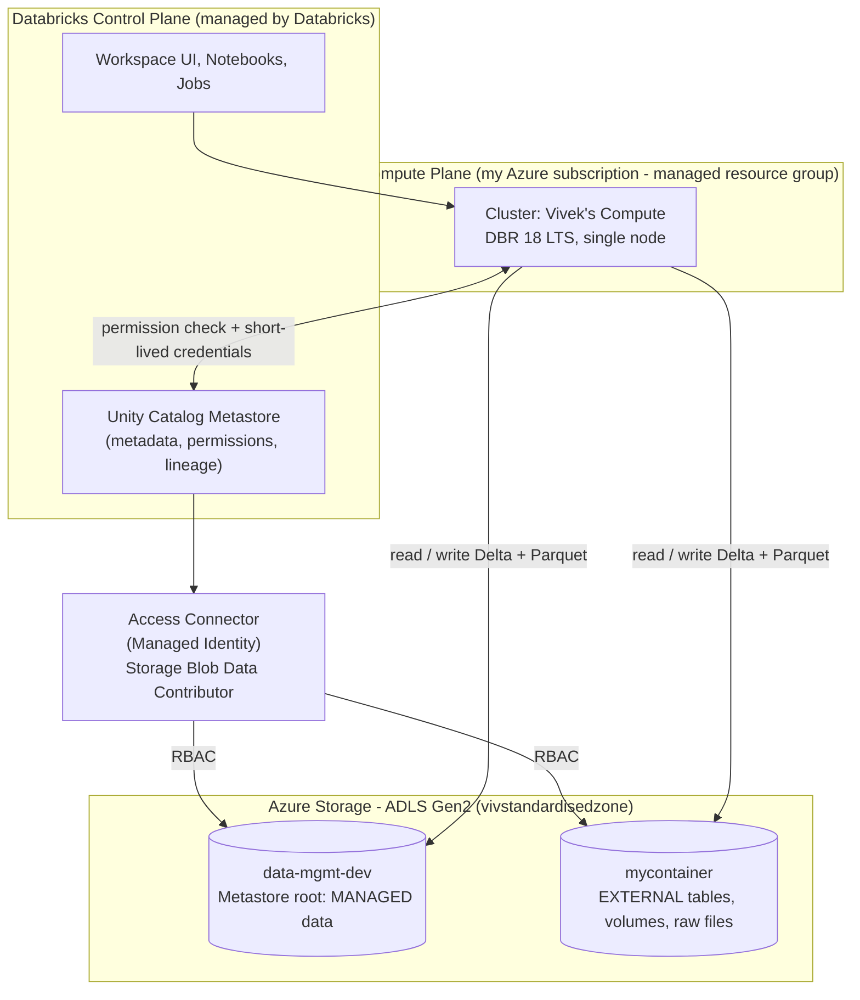
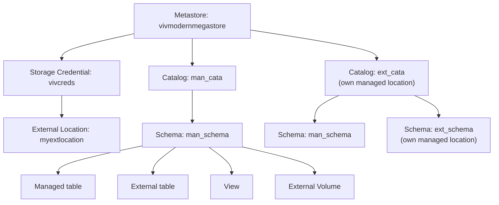
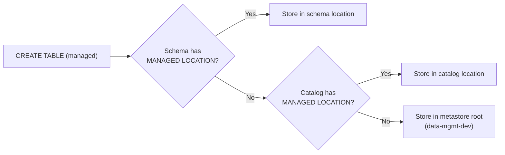
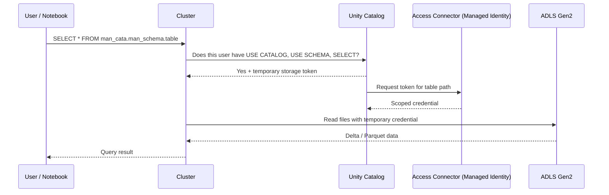
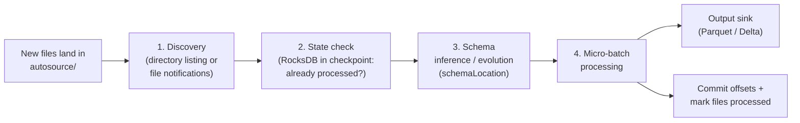

# 🧱 Azure Databricks Lakehouse with Unity Catalog, Delta Lake and Auto Loader

### An end-to-end, hands-on data engineering project: secure workspace setup, governed storage, Delta Lake internals and incremental ingestion on Azure


---

## 🎯 Project Overview

This repository documents a **complete, hands-on build of a governed Lakehouse on Azure Databricks**, from creating the cloud resources to exploring how **Delta Lake** works at file level and ingesting data incrementally with **Auto Loader**.

Instead of only running notebooks, the project focuses on **understanding what happens behind each command**: which resources Azure creates, how Unity Catalog decides where data is stored, what files appear in the storage account after every operation, and how Delta's transaction log makes versioning and time travel possible.

> **In one sentence:** *Provision Azure Databricks securely, govern all data through Unity Catalog, then study Delta Lake and Auto Loader by inspecting the real files they create in ADLS Gen2.*

### Who is this for?
- Learners who want a **clear, practical walkthrough** of Azure Databricks + Unity Catalog.
- Data engineers preparing for **interviews** (concepts, internals and Q&A are included in the detailed guides).
- Anyone who wants to see **what actually sits in cloud storage** behind managed tables, external tables, volumes, deletion vectors and streaming checkpoints.

---

## 🧭 What This Project Covers

| Area | What was done |
|---|---|
| ☁️ **Azure setup** | Databricks workspace (Hybrid), managed resource group, ADLS Gen2 storage account with two containers, Access Connector with managed identity, RBAC role assignment |
| 🏛️ **Unity Catalog** | Custom metastore with own storage root, workspace attachment, admin configuration, storage credential, external location |
| 🗂️ **Managed vs External** | Four storage scenarios using catalog/schema managed locations and external tables, `DROP` / `UNDROP` behavior |
| 👁️ **Views & files** | Direct path queries, permanent vs temporary views, external volumes and `/Volumes` paths |
| 🔺 **Delta Lake** | Table creation, DML, transaction log (`.json`, `.crc`), `DESCRIBE HISTORY`, time travel, `RESTORE` |
| ⚡ **Deletion vectors** | Copy-on-write vs merge-on-read, file-level comparison between two tables |
| 🧬 **Clones** | Deep clone vs shallow clone |
| 🌊 **Auto Loader** | `cloudFiles` streaming ingestion, schema location, checkpoint, `availableNow` trigger, generated folder structure |
| 🔐 **Governance study** | Row filters, column masks, ABAC, tags, lineage, system tables, Delta Sharing, Lakehouse Federation |

---

## 🏗️ Architecture

### High-level architecture



### Unity Catalog object hierarchy



### Managed storage resolution (where does a managed table go?)



---

## 🛠️ Technology Stack

| Layer | Technology |
|---|---|
| Cloud | Microsoft Azure (Resource Groups, Storage Account, Access Connector, RBAC, Entra ID) |
| Data platform | Azure Databricks (Hybrid workspace), Databricks Runtime 18 LTS |
| Governance | Unity Catalog (metastore, catalogs, schemas, credentials, external locations, volumes) |
| Storage | Azure Data Lake Storage Gen2 (hierarchical namespace) |
| Table format | Delta Lake (Parquet + transaction log), deletion vectors, clones |
| Processing | Apache Spark, Spark SQL, PySpark, Structured Streaming |
| Ingestion | Auto Loader (`cloudFiles`) |
| Security | Managed identity, RBAC, Microsoft Authenticator (MFA) |
| Documentation | Markdown, Mermaid |


---

## 🧾 Environment Reference

| Item | Value |
|---|---|
| Databricks workspace | `VIV_ADB` (workspace type: **Hybrid**) |
| Managed resource group | `RGModernDBManaged` |
| Storage account | `vivstandardisedzone` (ADLS Gen2, hierarchical namespace enabled) |
| Metastore container | `data-mgmt-dev` (managed data) |
| External container | `mycontainer` (external data) |
| Access Connector | `accessvivstandardisedzone` |
| Metastore | `vivmodernmegastore` (region: **Central India**) |
| Storage credential | `vivcreds` |
| External location | `myextlocation` |
| Compute | Vivek's Compute: DBR 18 LTS, single node, `Standard_D4ds_v5`, auto-terminate after 20 minutes |
| Catalogs | `man_cata`, `ext_cata` |

> 🔒 **Security note:** no keys, secrets or tokens are used or stored anywhere in this project. Access to storage is entirely through a **managed identity (Access Connector) + Azure RBAC**.

---

## 🚀 Part 1: Platform Setup (Azure + Databricks + Unity Catalog)

### Step-by-step flow

```mermaid
flowchart LR
    A["1. Create Databricks<br/>workspace"] --> B["2. Sign in to<br/>Account Console + MFA"]
    B --> C["3. Remove default<br/>metastore"]
    C --> D["4. Create ADLS Gen2<br/>account + containers"]
    D --> E["5. Create<br/>Access Connector"]
    E --> F["6. Grant Storage Blob<br/>Data Contributor"]
    F --> G["7. Create metastore<br/>+ attach workspace"]
    G --> H["8. Create compute"]
    H --> I["9. Configure admin<br/>role"]
    I --> J["10. Storage credential<br/>+ external location"]
```




| # | Step | What I did | Why it matters |
|---|---|---|---|
| 1 | **Workspace** | Created `VIV_ADB` (Hybrid) with managed resource group `RGModernDBManaged` | Hybrid supports classic compute and serverless options |
| 2 | **Account console** | Signed in at `accounts.azuredatabricks.net` using my Entra UPN, set a password and configured Authenticator (MFA) | Account-level features (metastores, users, workspaces) are managed here |
| 3 | **Metastore cleanup** | Deleted the existing default metastore | So that I could define my **own storage root** and fully control where managed data lives |
| 4 | **Storage** | Created `vivstandardisedzone` with containers `data-mgmt-dev` and `mycontainer` | Separate managed data from external data |
| 5 | **Access Connector** | Created `accessvivstandardisedzone` | Gives Databricks a **managed identity**, so no secrets or keys are needed |
| 6 | **RBAC** | Storage account → Access control (IAM) → Add role assignment → **Storage Blob Data Contributor** → Managed identity → the access connector | The identity needs **data-plane** rights to read/write/delete blobs |
| 7 | **Metastore** | Created `vivmodernmegastore` in Central India, root path `abfss://data-mgmt-dev@vivstandardisedzone.dfs.core.windows.net/`, linked the access connector, attached `VIV_ADB` | Enables Unity Catalog on the workspace |
| 8 | **Compute** | Created *Vivek's Compute*: DBR 18 LTS, single node, `Standard_D4ds_v5`, terminate after 20 minutes | Cost-efficient learning cluster; Databricks created VM, disk, VNet and NIC in the managed resource group |
| 9 | **Admin access** | Replaced my Azure UPN admin identity with my Databricks login as admin | The UPN lacked `CREATE CATALOG`, so catalog creation options were missing |
| 10 | **External access** | Created storage credential `vivcreds` and external location `myextlocation` → `mycontainer` | Allows governed access to external storage paths |

### 💡 Theory: Control plane vs compute plane

| | Control plane | Compute plane |
|---|---|---|
| Owned by | Databricks | Classic: **my subscription**; Serverless: Databricks |
| Contains | UI, notebooks, jobs, cluster manager, Unity Catalog metadata | VMs / serverless compute that **process data** |
| Handles customer data? | No (orchestration only) | Yes (reads and writes **my** storage) |

### 💡 Theory: Why an Access Connector?

The **Access Connector for Azure Databricks** wraps a **managed identity**. Unity Catalog uses it to vend **short-lived, down-scoped credentials** to compute, after verifying the user's privileges. Users never see storage keys.



---

## 🗂️ Part 2: Unity Catalog Objects (Managed vs External)

### Concept

| | Managed table | External table |
|---|---|---|
| Storage location | Chosen by **Unity Catalog** (GUID folders) | Chosen by **me** via `LOCATION` |
| `DROP TABLE` | Deletes metadata **and data** (recoverable for 7 days) | Deletes **metadata only**; files remain |
| `UNDROP` | Supported | Not applicable (recreate table on same path) |
| Extra privilege | None | `CREATE EXTERNAL TABLE` on the external location |
| Best for | Default choice, curated data | Data shared with other tools or already in the lake |

### The four scenarios I implemented

#### Scenario 1: Managed catalog → managed schema → managed table
```sql
CREATE CATALOG man_cata;
CREATE SCHEMA  man_cata.man_schema;

CREATE TABLE man_cata.man_schema.man_table (id INT, name STRING) USING DELTA;
```
📍 Stored in the **metastore root** (`data-mgmt-dev`).

#### Scenario 2: Catalog with its own managed location
```sql
CREATE CATALOG ext_cata
MANAGED LOCATION 'abfss://mycontainer@vivstandardisedzone.dfs.core.windows.net/external_catalog';

CREATE SCHEMA ext_cata.man_schema;

CREATE TABLE ext_cata.man_schema.man_table2 (id INT, name STRING) USING DELTA;
```
📍 Table is still **managed**, but stored under `mycontainer/external_catalog`.

#### Scenario 3: Schema with its own managed location
```sql
CREATE SCHEMA ext_cata.ext_schema
MANAGED LOCATION 'abfss://mycontainer@vivstandardisedzone.dfs.core.windows.net/ext_schema';

CREATE TABLE ext_cata.ext_schema.man_table3 (id INT, name STRING) USING DELTA;
```
📍 Schema location **overrides** the catalog location.

#### Scenario 4: External table
```sql
CREATE TABLE man_cata.man_schema.ext_table (id INT, name STRING)
USING DELTA
LOCATION 'abfss://mycontainer@vivstandardisedzone.dfs.core.windows.net/ext_table/man_table3';
```
📍 **I** own the folder; dropping the table keeps the files.

### Summary

| # | Catalog | Schema | Table type | Physical location |
|---|---|---|---|---|
| 1 | default | default | Managed | `data-mgmt-dev` (metastore root) |
| 2 | own location | default | Managed | `mycontainer/external_catalog` |
| 3 | own location | own location | Managed | `mycontainer/ext_schema` |
| 4 | default | default | **External** | `mycontainer/ext_table/man_table3` |

### DROP and UNDROP
```sql
DROP TABLE   man_cata.man_schema.man_table;   -- disappears from the workspace
UNDROP TABLE man_cata.man_schema.man_table;   -- restored (within 7 days)
```
**Observed:** after `DROP`, the table vanished from the workspace but its files were still physically present in Azure storage during the recovery window.

---

## 👁️ Part 3: Views, Files and Volumes

### Querying files directly
```sql
INSERT INTO man_cata.man_schema.ext_table VALUES (1,'Viv'), (2,'Bhand'), (3,'Raw Agent');

SELECT * FROM delta.`abfss://mycontainer@vivstandardisedzone.dfs.core.windows.net/ext_table/man_table3`
WHERE id = 1;
```

### Permanent vs temporary views
```sql
-- Permanent: registered in Unity Catalog
CREATE VIEW man_cata.man_schema.view1 AS
SELECT * FROM delta.`abfss://mycontainer@vivstandardisedzone.dfs.core.windows.net/ext_table/man_table3`
WHERE id = 1;

-- Temporary: lives only in this Spark session
CREATE OR REPLACE TEMP VIEW temp_view AS
SELECT * FROM delta.`abfss://mycontainer@vivstandardisedzone.dfs.core.windows.net/ext_table/man_table3`
WHERE id = 1;
```

| | Permanent view | Temporary view |
|---|---|---|
| Stored in | Unity Catalog | Session memory |
| Name | `catalog.schema.view` | `view_name` |
| Lifetime | Until dropped | Until session ends |
| Shareable / grantable | ✅ | ❌ |
| Appears in lineage | ✅ | ❌ |

### Volumes (governed file access)

A **volume** gives Unity Catalog governance to **non-tabular files** (CSV, JSON, images, PDFs...). Files are accessed with `/Volumes/<catalog>/<schema>/<volume>/<path>`.

```python
dbutils.fs.mkdirs('abfss://mycontainer@vivstandardisedzone.dfs.core.windows.net/volumes')
```
```sql
CREATE EXTERNAL VOLUME man_cata.man_schema.extvolume
LOCATION 'abfss://mycontainer@vivstandardisedzone.dfs.core.windows.net/volumes';
```
```python
dbutils.fs.cp(
  'abfss://mycontainer@vivstandardisedzone.dfs.core.windows.net/source/Sales',
  'abfss://mycontainer@vivstandardisedzone.dfs.core.windows.net/volumes/Sales'
)   # use recurse=True if "Sales" is a folder
```
```sql
SELECT * FROM csv.`/Volumes/man_cata/man_schema/extvolume/Sales`;
```

---

## 🔺 Part 4: Delta Lake Internals

### Theory: what is a Delta table?

> **Delta table = Parquet data files + `_delta_log` (transaction log).**

Parquet files are **immutable**. Every change is made by writing **new files** and recording in the log which files belong to the current version of the table. This single idea explains ACID transactions, updates, time travel, restore and clones.

```
deltatbl/
├── _delta_log/
│   ├── 00000000000000000000.json   ← commit (actions: protocol, metaData, add, remove, commitInfo)
│   ├── 00000000000000000000.crc    ← per-version checksum / summary
│   ├── ...
│   └── 00000000000000000010.checkpoint.parquet   ← state snapshot (about every 10 commits)
├── part-00000-....snappy.parquet   ← data files
└── part-00001-....snappy.parquet
```

### Hands-on: create a table and turn deletion vectors **off**
```sql
CREATE TABLE man_cata.man_schema.deltatbl (id INT, name STRING, city STRING)
USING DELTA
LOCATION 'abfss://mycontainer@vivstandardisedzone.dfs.core.windows.net/deltalake/deltatbl';

ALTER TABLE man_cata.man_schema.deltatbl
SET TBLPROPERTIES ('delta.enableDeletionVectors' = false);   -- classic copy-on-write behavior

INSERT INTO man_cata.man_schema.deltatbl VALUES (1,'aa','delhi'), (2,'bb','mumbai'), (3,'cc','chennai');

DESCRIBE EXTENDED man_cata.man_schema.deltatbl;
SELECT * FROM man_cata.man_schema.deltatbl;
```

### UPDATE (copy-on-write)
```sql
UPDATE man_cata.man_schema.deltatbl SET city = 'toronto' WHERE id = 1;
```

**Observed in Azure storage:** before the update there was **one Parquet file** with 3 rows; after the update there were **two Parquet files**.

```
BEFORE UPDATE (v2)              AFTER UPDATE (v3)

File 1 [1 aa delhi  ]          File 1 [1 aa delhi  ]   ← "removed" in the log, still on storage
       [2 bb mumbai ]                 [2 bb mumbai ]
       [3 cc chennai]                 [3 cc chennai]
                               File 2 [1 aa toronto]   ← new active file (latest data)
                                      [2 bb mumbai ]
                                      [3 cc chennai]
```

| Why? | Explanation |
|---|---|
| Parquet is immutable | The row cannot be edited in place, so the whole file is rewritten with the change |
| `remove` ≠ delete | The log marks File 1 as *not part of the current version*, but it stays so that **older versions can be read** |
| Physical cleanup | Only `VACUUM` deletes it (default retention: 7 days) |

### Transaction log in action

| Version | Operation | Log actions |
|---|---|---|
| 0 | `CREATE TABLE` | `protocol`, `metaData` |
| 1 | `SET TBLPROPERTIES` | `metaData` (DV property) |
| 2 | `WRITE` (INSERT) | `add` File 1 (with min/max statistics) |
| 3 | `UPDATE` | `remove` File 1 + `add` File 2 |
| 4 | `RESTORE` | `remove` File 2 + `add` File 1 |

- **`.json` file** = the authoritative record of one commit (list of actions).
- **`.crc` file** = a small checksum/summary of the table state after that commit (size, file count, metadata, protocol) used for validation and faster snapshot loading.
- **Checkpoint** = full state snapshot so readers do not replay every commit.

### History, time travel and RESTORE
```sql
DESCRIBE HISTORY man_cata.man_schema.deltatbl;

SELECT * FROM man_cata.man_schema.deltatbl VERSION AS OF 2;     -- query old data

RESTORE man_cata.man_schema.deltatbl TO VERSION AS OF 2;        -- bring old data back
```

✅ **Result:** the table returned to the pre-update data. `RESTORE` **copies no data**; it writes a new commit that points back to the older file, so history is preserved (a new version is added).

---

## ⚡ Part 5: Deletion Vectors

### Hands-on: same operations on a table with deletion vectors **ON** (default)
```sql
CREATE TABLE man_cata.man_schema.deltatbl2 (id INT, name STRING, city STRING)
USING DELTA
LOCATION 'abfss://mycontainer@vivstandardisedzone.dfs.core.windows.net/deltalake/deltatbl2';

INSERT INTO man_cata.man_schema.deltatbl2 VALUES (1,'aa','delhi'), (2,'bb','mumbai'), (3,'cc','chennai');

UPDATE man_cata.man_schema.deltatbl2 SET city = 'seattle' WHERE id = 1;
```

**Observed in Azure storage:** **3 Parquet files + 1 deletion vector (`.bin`) file.**

### How to read that result

| Item | Role |
|---|---|
| Parquet file **A** | Original data file containing the row with `id = 1` (and another row); that row is now hidden by the deletion vector |
| Parquet file **B** | Original data file, untouched |
| Parquet file **C** | **New small file** containing only the updated row `(1,aa,seattle)` |
| `deletion_vector_<uuid>.bin` | Compact bitmap of **row positions** to ignore in file A (it stores positions, not row values) |

```
AFTER INSERT                         AFTER UPDATE (deletion vectors ON)

File A [0] 1 aa delhi                File A [0] 1 aa delhi    ← masked by DV (hidden at read time)
       [1] 2 bb mumbai                      [1] 2 bb mumbai   ← visible
File B [0] 3 cc chennai              File B [0] 3 cc chennai  ← untouched
                                     File C [0] 1 aa seattle  ← new, only the changed row
                                     deletion_vector_<uuid>.bin ← "File A, row 0 deleted"
```

> The exact number of files produced by a small `INSERT` can vary with cluster parallelism. The mechanism (original files stay, a DV masks changed rows, a small new file holds the new values) is the same.

### Copy-on-write vs merge-on-read

| | `deltatbl` (DV **off**) | `deltatbl2` (DV **on**) |
|---|---|---|
| Strategy | **Copy-on-write** | **Merge-on-read** |
| UPDATE of one row | Rewrites the **entire file** | Writes a DV + a tiny file with just the new row |
| Write cost | High (write amplification) | **Low** |
| Read | Simple | Applies the DV while reading (cleaned up by `OPTIMIZE`) |

### Why deletion vectors improve write performance
- Far **less I/O** for `UPDATE`, `DELETE` and `MERGE` (no rewriting of large files for a few changed rows).
- **Lower compute and storage cost**, shorter write transactions and fewer conflicts between concurrent writers.
- Maintenance: `OPTIMIZE` or `REORG TABLE ... APPLY (PURGE)` rewrites files so deleted rows are physically removed (important for GDPR-style erasure, followed by `VACUUM`).

### Without Deletion Vector


### With Deletion Vector


---

## 🧬 Part 6: Deep Clone vs Shallow Clone

```sql
-- Deep clone: copies metadata AND data files
CREATE TABLE man_cata.man_schema.deepclonetbl
DEEP CLONE man_cata.man_schema.deltatbl;

-- Shallow clone: copies only the transaction log, references the source files
CREATE TABLE man_cata.man_schema.shallowclonetbl
SHALLOW CLONE man_cata.man_schema.man_table;
```

```
DEEP      source files ──copy──► clone files        independent, slower, backup-safe
SHALLOW   source files ◄─refer── clone log          instant, depends on source, test-friendly
```

| | **Deep clone** | **Shallow clone** |
|---|---|---|
| Data files | Copied | **Referenced** from the source |
| Creation time | Proportional to data size | Seconds |
| Extra storage | Full copy | Almost none at first |
| Independent of source | ✅ | ❌ (depends on source files) |
| Safe if the source is vacuumed/dropped | ✅ | ⚠️ May break |
| Typical use | Backup, DR, migration, archive | Dev/test, safe experiments, sandboxes |

Writes to a clone never change the source, and changes to the source do not flow into the clone.

---

## 🌊 Part 7: Auto Loader (Incremental Ingestion)

### What is Auto Loader?
**Auto Loader** (`cloudFiles`) is a Structured Streaming source that **incrementally discovers and ingests only new files** from cloud storage with **exactly-once** guarantees and built-in **schema inference and evolution**.

### The code
```python
base = "abfss://mycontainer@vivstandardisedzone.dfs.core.windows.net"

df = (spark.readStream.format("cloudFiles")
    .option("cloudFiles.format", "parquet")
    .option("cloudFiles.schemaLocation", f"{base}/autosink/schema")
    .load(f"{base}/autosource"))

(df.writeStream.format("parquet")
    .option("checkpointLocation", f"{base}/autosink/checkpoint")
    .trigger(availableNow=True)
    .start(f"{base}/autosink/data"))
```

| Line | Purpose |
|---|---|
| `format("cloudFiles")` | Use the Auto Loader source |
| `cloudFiles.format` | Format of incoming files |
| `cloudFiles.schemaLocation` | Folder where the inferred schema (and its evolution history) is stored |
| `.load(".../autosource")` | Input directory to watch |
| `checkpointLocation` | Stores stream progress and the list of already-processed files |
| `trigger(availableNow=True)` | Process everything currently available, then **stop** (incremental batch) |
| `.start(".../autosink/data")` | Output path |

### How it works internally



### Folders and files created after running

```
mycontainer/
├── autosource/                       ← input files
└── autosink/
    ├── schema/_schemas/0             ← inferred schema (versioned, JSON)
    ├── checkpoint/
    │   ├── metadata                  ← stream (query) id
    │   ├── offsets/0                 ← planned work for batch 0
    │   ├── commits/0                 ← batch 0 completed
    │   └── sources/0/rocksdb/        ← processed-file state (exactly-once)
    └── data/
        ├── part-*.snappy.parquet     ← ingested data
        └── _spark_metadata/0         ← files committed by batch 0 (file sink log)
```

| Scenario | Result |
|---|---|
| Run again with **no new files** | Nothing is processed |
| Add **new files** and run again | Only the new files are read (`offsets/1`, `commits/1`, new output file) |
| Delete the **checkpoint** | Everything is re-ingested (duplicates possible) |
| New column appears | With default `addNewColumns`, the run fails once, the schema file is updated and the next run succeeds |

### Why Auto Loader instead of a plain file read?

| | Plain batch read | Spark file stream | **Auto Loader** |
|---|---|---|---|
| Incremental | ❌ | ✅ | ✅ |
| Scales to millions of files | ❌ | ❌ (relists directory) | ✅ |
| Schema evolution + `_rescued_data` | Manual | Limited | ✅ Built-in |
| Exactly-once | Manual | ✅ | ✅ |

> 💡 In production the usual pattern is a **Delta sink** (`.toTable("catalog.schema.bronze_table")`) instead of raw Parquet, which adds ACID, history and governance.

---

## 🔐 Governance Capabilities Studied

Beyond the hands-on parts, I studied the Unity Catalog governance model from the Microsoft Learn documentation. Details and examples are in the guide (`docs/`).

| Capability | Summary |
|---|---|
| **Privileges and inheritance** | `USE CATALOG` + `USE SCHEMA` + `SELECT` are all needed to read a table; grants inherit downwards |
| **Admin roles** | Account admin, metastore admin, workspace admin |
| **Storage governance** | Storage credentials, external locations, volumes (replace mounts and keys) |
| **Row filters and column masks** | Fine-grained security via SQL functions |
| **ABAC and tags** | Policies driven by governed tags such as `sensitivity = pii` |
| **Lineage** | Automatic table and column level lineage |
| **Auditing and system tables** | `system.access.audit`, lineage and billing tables |
| **Delta Sharing** | Open protocol for sharing live data without copying |
| **Lakehouse Federation** | Query external databases in place, governed by Unity Catalog |
| **Workspace-catalog binding** | Restrict which workspaces can use a catalog (e.g. prod isolation) |

### Without vs with Unity Catalog

| | Without Unity Catalog | With Unity Catalog |
|---|---|---|
| Scope | Per workspace (Hive metastore) | Account-wide, shared by workspaces |
| Namespace | `schema.table` | `catalog.schema.table` |
| Storage access | Mounts, keys, shared credentials | Credentials + external locations |
| Security | Cluster / table ACLs | Central `GRANT`/`REVOKE`, row/column security |
| Lineage and audit | Not available / scattered | Built in |

---

## ✅ Key Advantages of This Architecture

| Advantage | How the project demonstrates it |
|---|---|
| 🔐 **Secretless security** | Managed identity + RBAC; no storage keys, SAS tokens or passwords in code |
| 🏛️ **Centralized governance** | One metastore governs tables, files (volumes) and storage access across workspaces |
| 📍 **Controlled data placement** | Catalog/schema managed locations decide exactly which container holds which data |
| 💸 **Open, low-cost storage** | Data stays in the customer's ADLS Gen2 as open Parquet/Delta files, with no vendor lock-in on the data |
| 🔁 **Reliability** | Delta ACID transactions and the transaction log prevent partial or corrupt writes |
| ⏪ **Recoverability** | Time travel, `RESTORE`, and `UNDROP` allow quick recovery from mistakes |
| ⚡ **Efficient updates** | Deletion vectors avoid rewriting whole files for small changes |
| 🧪 **Safe experimentation** | Shallow clones allow testing on production-like data without copying it |
| 🌊 **Scalable incremental ingestion** | Auto Loader processes only new files with exactly-once guarantees |
| 💰 **Cost control** | Single-node cluster, 20-minute auto-termination, `availableNow` trigger for batch-style streaming |

---

## 🎓 What I Learned

**Cloud and platform**
- How Azure organizes resources (tenant → subscription → resource group → resource) and why a **managed resource group** exists.
- The difference between the **control plane** and **compute plane**, and what Databricks creates in my subscription (VMs, disks, VNet, NICs).
- Why **ADLS Gen2** (hierarchical namespace) is needed, and how `abfss://` paths are built.
- Why **managed identity + a data-plane role** (Storage Blob Data Contributor) is the correct way to grant storage access, and why *Contributor* alone is not enough.

**Unity Catalog**
- How the **metastore** stores metadata only, while data lives in my storage.
- How managed storage is resolved: **schema → catalog → metastore root**.
- How **storage credentials** (who) and **external locations** (where) work together.
- Difference between **managed and external tables**, `DROP` behavior and `UNDROP`.
- Why **permissions need three levels** (`USE CATALOG`, `USE SCHEMA`, `SELECT`), and why a Databricks admin identity was required to create catalogs.
- Why volumes are the governed way to handle files.

**Delta Lake**
- Parquet files are **immutable**: updates create new files, and the log decides which files are active.
- How **time travel** works physically (older files remain until `VACUUM`) and how `RESTORE` re-points the log.
- The roles of `.json` commit files, `.crc` checksum files and checkpoints.
- **Copy-on-write vs merge-on-read** and exactly why deletion vectors reduce write cost.
- Deep vs shallow clone trade-offs and where each belongs (backup vs testing).

**Streaming ingestion**
- How Auto Loader tracks files with a checkpoint, infers and evolves schema, and what each generated folder (`offsets`, `commits`, `rocksdb`, `_schemas`, `_spark_metadata`) contains.
- Why `availableNow` gives streaming guarantees with batch cost.

**Engineering mindset**
- Verify theory by **inspecting the storage layer** after every operation.
- Keep naming, separation of concerns (managed vs external containers) and least privilege in mind from day one.

---

## 🧩 Challenges and How I Solved Them

| Challenge | Cause | Solution |
|---|---|---|
| No "Create catalog" option in Catalog Explorer | My signed-in Entra UPN identity had no `CREATE CATALOG` on the metastore | Set my Databricks account login as admin (account/metastore admin) |
| Metastore needed my own storage | Default metastore used Databricks-chosen storage | Deleted the default metastore and created `vivmodernmegastore` with `data-mgmt-dev` as root |
| Databricks could not access storage | Access Connector had no data permissions | Assigned **Storage Blob Data Contributor** to the connector's managed identity |
| Understanding where files really go | Managed table paths are GUID folders | Used `DESCRIBE EXTENDED`/`DESCRIBE DETAIL` and browsed the container |
| Why files multiplied after an update | Parquet immutability | Studied the Delta log (`add`/`remove`), then compared DV on vs off |

---

## 📐 Best Practices Followed

- ✅ **No secrets**: managed identity with RBAC instead of keys.
- ✅ **Separate containers** for managed and external data.
- ✅ **Own metastore root storage** for control and isolation.
- ✅ **Auto-termination (20 min)** on compute to avoid idle cost.
- ✅ **Delta format everywhere** for reliability and history.
- ✅ **Governed access** through external locations and volumes instead of mounts.
- ✅ **Documented naming** and environment reference for reproducibility.

---

## 🔁 How to Reproduce This Project

### Prerequisites
- An Azure subscription with permission to create resources and assign RBAC roles.
- Ability to create an Azure Databricks workspace (**Premium tier** is required for Unity Catalog).
- Access to the Databricks **account console** (`accounts.azuredatabricks.net`).

### Quick path
1. Create the **Azure Databricks workspace** (note the managed resource group name).
2. Create an **ADLS Gen2 storage account** (enable *hierarchical namespace*) with two containers (managed and external).
3. Create an **Access Connector for Azure Databricks**; assign it **Storage Blob Data Contributor** on the storage account.
4. In the **account console**: create a **metastore** (same region as the workspace), set the root ADLS path, add the access connector ID and attach the workspace.
5. Make sure your Databricks identity is a **metastore/account admin**.
6. Create a **cluster** (DBR LTS, single node for learning, auto-termination on).
7. Create a **storage credential** (the access connector) and an **external location** (your external container).
8. Run the notebooks in order:

| Order | Notebook | Topic |
|---|---|---|
| 1 | `01_unity_catalog_managed_external.ipynb` | Catalogs, schemas, managed/external tables, DROP/UNDROP |
| 2 | `02_views_and_volumes.ipynb` | Path queries, views, temp views, volumes |
| 3 | `03_delta_lake_internals.ipynb` | Updates, log, history, time travel, restore |
| 4 | `04_deletion_vectors.ipynb` | Copy-on-write vs deletion vectors |
| 5 | `05_clones.ipynb` | Deep and shallow clones |
| 6 | `06_auto_loader.ipynb` | Incremental ingestion with `cloudFiles` |

> Replace the storage account and container names in the paths with your own. Do **not** commit any real subscription IDs, tenant IDs or resource IDs.

---

## 👤 Author

**Vivek**
Aspiring Data Engineer | Azure | Databricks | Delta Lake | Apache Spark

---

*Built as a hands-on learning project: every concept here was verified by running the commands and inspecting the files in Azure storage.*

</div>
